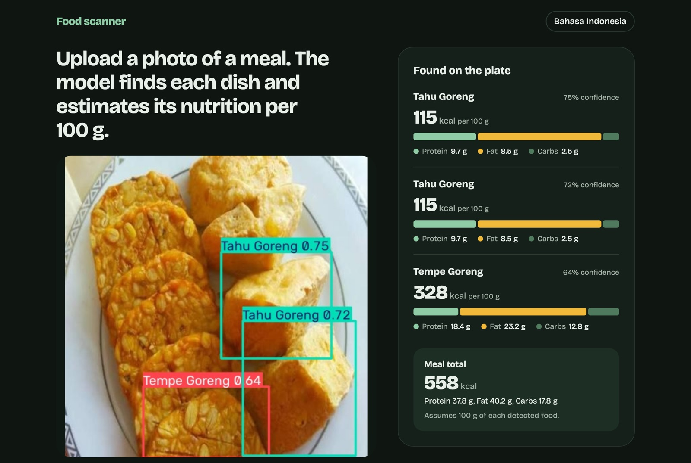
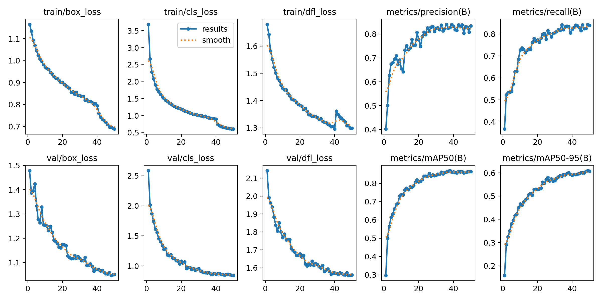
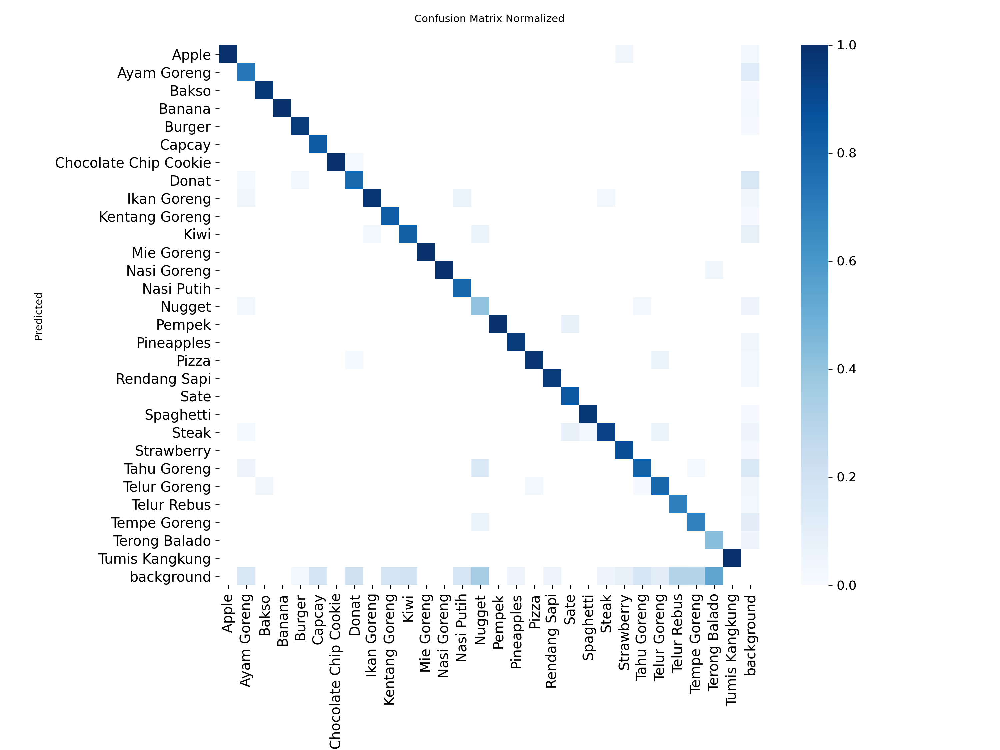

# AI Food Detection with Nutrition Information

A Flask web app that detects Indonesian and common foods in a photo with a custom-trained **YOLOv8** model, draws bounding boxes on the image, and shows estimated nutrition (calories, protein, fat, carbohydrates per 100 g) for each detected item.

**Live demo:** https://huggingface.co/spaces/perfectlyx/indonesian-food-scanner



## Features

- Drag-and-drop or click to upload a photo, with a preview before detecting
- Bounding boxes and confidence for every detected food
- Calories per 100 g with a protein / fat / carbs breakdown, plus a meal total
- English and Bahasa Indonesia interface
- Works on phones, and follows the system light or dark theme

## Model performance

YOLOv8n fine-tuned for 50 epochs (640 px, batch 8) on the [Indonesian Food dataset](https://universe.roboflow.com/a-hsxke/indonesian-food-cd2d4/dataset/8) from Roboflow: 29 classes, 8,308 train / 680 validation / 270 test images.

| Metric (validation) | Score |
| --- | --- |
| Precision | 0.834 |
| Recall | 0.839 |
| mAP@50 | 0.864 |
| mAP@50-95 | 0.607 |

| Training curves | Confusion matrix |
| --- | --- |
|  |  |

**Classes:** Apple, Ayam Goreng, Bakso, Banana, Burger, Capcay, Chocolate Chip Cookie, Donat, Ikan Goreng, Kentang Goreng, Kiwi, Mie Goreng, Nasi Goreng, Nasi Putih, Nugget, Pempek, Pineapples, Pizza, Rendang Sapi, Sate, Spaghetti, Steak, Strawberry, Tahu Goreng, Telur Goreng, Telur Rebus, Tempe Goreng, Terong Balado, Tumis Kangkung.

## Tech stack

- [Ultralytics YOLOv8](https://github.com/ultralytics/ultralytics) for object detection
- Flask for the web app
- pandas for the nutrition lookup
- OpenCV for image handling

## Run locally

Requires Python 3.10+.

```bash
git clone https://github.com/Ahmad-FikriA/ai_food_detection.git
cd ai_food_detection
python -m venv .venv
source .venv/bin/activate        # Windows: .venv\Scripts\activate
pip install -r requirements.txt
python app.py
```

Open http://127.0.0.1:5000 and upload a food photo (JPG, PNG, WEBP or BMP, up to 10 MB). The trained weights are included at `model/best.pt`.

- `PORT` sets the port (default 5000). On macOS, AirPlay uses 5000, so run `PORT=5055 python app.py`.
- `FLASK_DEBUG=1` enables Flask's debug mode.

## Project structure

```
app.py                 Flask app: upload, detection, nutrition lookup
main.py                Command-line script used during development
model/best.pt          Trained YOLOv8n weights
nutrition_data.csv     Nutrition per 100 g for each class
templates/, static/    Web UI
runs/detect/train/     Training metrics and plots
```

## Retraining

Download the dataset from Roboflow in YOLOv8 format into `Indonesian-Food-8/`, then:

```bash
yolo detect train model=yolov8n.pt data=Indonesian-Food-8/data.yaml epochs=50 imgsz=640 batch=8
```

Copy the resulting `runs/detect/train/weights/best.pt` to `model/best.pt`.

## Deploying to Hugging Face Spaces

The live demo runs on a Gradio Space. `space_app.py` serves the Flask app at `/` and a Gradio demo with an API at `/gradio`, both on port 7860. Space-only config (README header, requirements, system packages) lives in `deploy/hf-space/`.

```bash
hf auth login                 # once, with a write token
./deploy/hf-space/deploy.sh   # uploads only the files the app needs
```

## Limitations

- Nutrition values are approximate per 100 g. The app does not estimate portion size.
- Values are general reference figures and vary with recipe and preparation.

## Credits

Dataset: [Indonesian Food](https://universe.roboflow.com/a-hsxke/indonesian-food-cd2d4/dataset/8) on Roboflow Universe, licensed CC BY 4.0.
